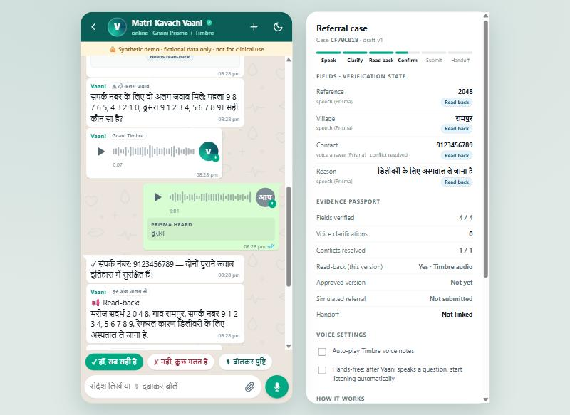
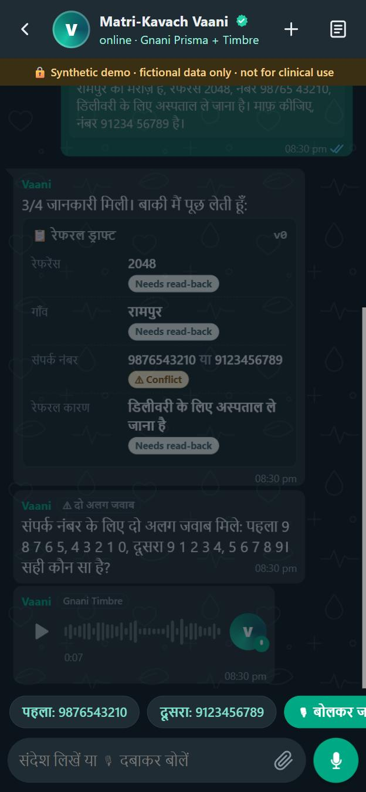
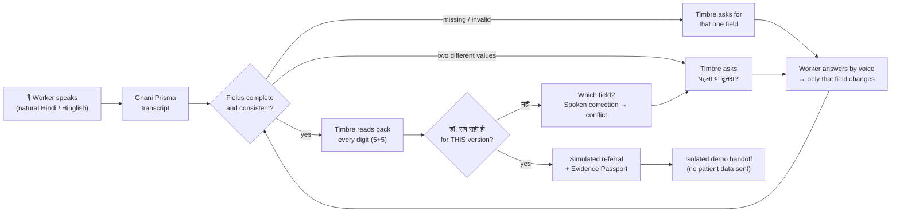
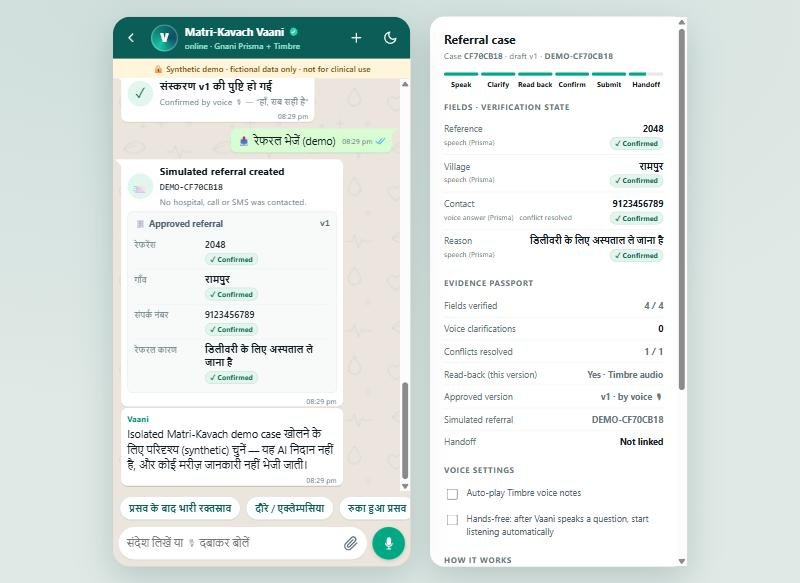

<div align="center">

# Matri-Kavach Vaani

### A Hindi voice assistant that won't let a wrong digit through.

The health worker speaks a referral. **Vaani** finds what is missing or contradictory, asks for it aloud, reads every digit back, and submits nothing until the worker says **"हाँ, सब सही है"** for that exact version.


**🎥 Demo video:** _add link_ · **💼 LinkedIn:** _add link_ · **🐦 X:** _add link_

Built for the **Great Indian AI Internship Challenge** by Gnani AI.

</div>

<p align="center">
  
  &nbsp;
  
</p>
<p align="center"><sub>The chat view. Vaani heard two phone numbers, so it picks neither. It asks with a Timbre voice note, the worker answers <b>"दूसरा"</b> by voice, and Prisma's transcript is shown under the reply. All data is fictional.</sub></p>

> ⚠️ **Research and hackathon prototype. Synthetic data only.** Vaani does not diagnose, triage or dispatch. It must never be used with real patients.

---

## In 30 seconds

| | |
|---|---|
| **Problem** | ASHA workers send maternal-emergency referrals under pressure. One wrong digit in a phone number, or a missing village, costs time a mother in labour does not have. |
| **Who** | ASHA workers, ANMs and PHC staff. Many of them prefer speaking to typing. |
| **What it does** | The worker speaks naturally. If a detail is missing or two values conflict, Vaani **does not guess**: it asks aloud in Hindi, listens to the answer, reads every digit back, and submits only after the worker confirms by voice. |
| **Gnani models** | **Prisma** (speech-to-text) hears the referral and every answer. **Timbre** (text-to-speech) asks the questions and reads the details back. |
| **Proof** | 194 automated tests · **0 false-ready referrals** across 24 adversarial cases and 15 bypass attempts · a live Gnani run of the conflict → spoken answer → read-back loop. |

## The problem

- Field researchers found that ASHAs **rarely type on their phones** and use voice dictation and WhatsApp voice notes instead ([George Institute, 2025](https://cdn.georgeinstitute.org/sites/default/files/2025-05/Large-AI-model-community-health-workers.pdf)).
- Studies of Indian maternal referrals describe incomplete referral slips and delays in reaching and receiving care ([Public Health, 2022](https://www.ncbi.nlm.nih.gov/pmc/articles/PMC9883712/)).
- Voice dictation alone does not fix this. It moves the error from the keyboard to the transcript. The missing step is a **closed loop**: ask, read back, confirm. Aviation and hospital "read-back" protocols use the same idea for critical numbers.

## How it works



## Two ways to use it

| **Chat view: `/chat`** | **Dashboard: `/`** |
|---|---|
| A mobile-first chat built around **voice notes**, the way ASHAs already work. The worker sends a voice note and Vaani replies with Timbre voice notes. Quick-reply chips cover "पहला / दूसरा" and "हाँ, सब सही है". Draft cards show the state of each field, and a case panel (a bottom sheet on mobile) holds the Evidence Passport. **Hands-free:** after Vaani speaks, the mic opens by itself. Dark mode is included. | A reviewer and audit view. Every field can be edited, and it shows the read-back controls, the full activity timeline and the raw audit JSON. |

<p align="center"></p>
<p align="center"><sub>After "हाँ, सब सही है": confirmed by voice, every field shows ✓, and the Evidence Passport records <b>v1 · by voice</b>.</sub></p>

## What makes it different

| | Capability | What happens |
|---|---|---|
| 🗣 | **Understands natural speech** | "रामपुर की मरीज़ है, नंबर 98765 43210, डिलीवरी के लिए अस्पताल ले जाना है" fills all four fields, without keywords like "patient ID". |
| ❓ | **Asks instead of guessing** | If a field is missing, Timbre asks in Hindi ("गाँव का नाम नहीं मिला। कृपया गाँव का नाम बताइए।"). The spoken answer fills **only that field**. |
| ⚠️ | **Contradiction-aware** | If it hears two different phone numbers, it picks neither and asks "पहला … दूसरा … सही कौन सा है?". The worker answers "पहला/दूसरा", says the value, or taps it. |
| 🔁 | **No silent overwrites** | A spoken correction ("रामपुर नहीं, सोनपुर") keeps both values as a conflict and cancels any earlier approval. The history keeps both values. |
| 🔢 | **ICAO-style read-back** | Phone numbers are read one digit at a time, grouped 5+5: "9 8 7 6 5, 4 3 2 1 0". |
| ✅ | **Hands-free, strict confirmation** | Only "हाँ, सब सही है" confirms, and only after the Timbre read-back **audio** of that exact version. A bare "हाँ" is not enough, and any "नहीं/गलत" never confirms. |
| 🙅 | **Rejects non-answers** | "हाँ", "ok", "kya?", "पता नहीं" and silence never become a value. Negation in a clinical reason ("साँस नहीं आ रही") is kept as said. |
| 🧩 | **Built for real Prisma output** | It handles Devanagari numerals (९८७६…), ITN ordinals ("१st" → पहला), spoken digit words, "double five", and English markers written in Devanagari ("विलेज", "रीज़न"). |
| 🧾 | **Evidence Passport** | Records what was heard, changed and approved: fields verified, conflicts resolved, whether the read-back covers this version, and who approved which version and how. It contains no patient values. |

## Gnani models used

| Model | Used for | How |
|---|---|---|
| **Prisma v2.5** (default: `hi-IN`, `format=transcribe`, native-numeral ITN) | The referral, every clarification answer, spoken corrections and the spoken confirmation | REST `POST /stt/v3`. The browser records 16 kHz mono WAV, because the REST API does not accept webm. |
| **Prisma v3.0** (`GNANI_STT_PROFILE=codemix`) | Optional Hinglish profile | `language_code=hi-IN,en-IN`, `format=codemix`. Vaani's question is sent as `previous_text`, so short replies such as "दूसरा" are transcribed in context. |
| **Timbre v2.5** (Nalini) or **v3.0** (Shivani) | Clarification questions, the confirmation question and the digit-by-digit read-back | REST `POST /api/v1/tts/inference`, Hindi WAV. |

## Evidence

| What | Result | Reproduce |
|---|---|---|
| Automated tests (offline, with Gnani stubbed) | **194 / 194 pass** | `py -m unittest discover -s tests` |
| **False-ready safety eval:** 24 transcripts pushed straight to submit, 15 bypass attempts (5 of them voice-confirmation tricks), 26 non-answers | **0 false-ready · 0 bypasses · 0 non-answers accepted.** With the guards deliberately broken, the same eval catches the failures. | `py benchmarks\run_safety_eval.py` → [report](benchmarks/results/safety_eval_report.md) |
| **Natural-speech extraction** (14 fictional transcripts) | Marker words only: 30/56 fields and 3.43 questions per draft. **With natural speech: 56/56 fields, 0 wrong values, 1.57 questions per draft.** | `py benchmarks\run_natural_eval.py` → [report](benchmarks/results/natural_eval_report.md) |
| Fixture benchmark (hand-written transcripts) | 16/16 cases, 64/64 fields | `py benchmarks\run_benchmark.py` → [report](benchmarks/results/stage9_report.md) |
| **Live Gnani run** (developer key, fictional case) | Prisma transcribed a Hindi referral with Devanagari numerals, and all 4 fields were extracted. Timbre asked a conflict question, the spoken answer resolved it, and the Timbre read-back was generated. This run found two real bugs (ITN "१st", and a stale passport), both now fixed. | Manual run on 12–13 Nov 2026. To repeat: `py scripts\live_smoke_test.py` (15 checks) |
| Noise robustness (clean / 10 dB / 5 dB / 8 kHz phone) | Run it with your key. The report separates wrong values (dangerous) from abstentions (safe, because Vaani then asks). | `py benchmarks\run_tts_benchmark.py C:\private\tts_bench` |

These results check the workflow guardrails on synthetic input. They do not measure speech-recognition accuracy in the field, and none of this is clinical validation.

## Run it

```cmd
py -m pip install -r requirements.txt
py -m uvicorn app.main:app --host 127.0.0.1 --port 8000
```

Open **http://localhost:8000/chat** for the chat view, or **http://localhost:8000** for the dashboard.

**Mock mode** is the default and needs no key. Tap "Sample: दो अलग नंबर" or "Sample: अधूरी जानकारी" and answer by typing or tapping.

**Live mode** uses your Gnani key. Set it in the same terminal that starts the server:

```cmd
set GNANI_MODE=live
set GNANI_API_KEY=your_real_key
py scripts\check_gnani.py
py scripts\live_smoke_test.py
py -m uvicorn app.main:app --host 127.0.0.1 --port 8000
```

- `check_gnani.py` diagnoses the key and its access without printing the key.
- `live_smoke_test.py` runs the full voice loop. Timbre plays the worker.
- In PowerShell, use `$env:GNANI_MODE="live"` and `$env:GNANI_API_KEY="..."` instead.
- Optional settings: `GNANI_STT_PROFILE=codemix`, `GNANI_TIMBRE_MODEL=timbre-v3.0` and `GNANI_TIMBRE_VOICE=Shivani`.

## Safety by design

**Why field extraction is rule-based.** The AI in this project is Gnani's speech models. Turning a transcript into fields is deterministic on purpose:

- **No invented values.** A rule either finds a value or leaves the field empty. An empty field is the safe failure, because Vaani then asks for it aloud. A generative model could fill in a plausible but wrong phone number, and nothing would ask about it.
- **Every value can be explained.** Each field records where its value came from (speech, a voice answer or a manual edit). The Evidence Passport shows this.
- **It is testable.** The same transcript always gives the same fields, so the safety eval can show that nothing wrong gets through.

**Workflow guarantees:**

- An answer can only change the field that was asked about. Clarification never confirms anything.
- Every change creates a new version and cancels earlier read-backs and approvals.
- Submission needs a read-back and an explicit approval of the exact current version, and submission is idempotent.
- Keys stay on the server. They are cleaned of stray quotes and spaces, and never returned or logged.
- The demo handoff to the original Matri-Kavach Express engine sends **no patient fields**, creates no hospital routing and sends no messages.
- The public preview (`render.yaml`) runs only in mock mode, behind a shared demo password.

A language model could later *suggest* values for very free-form speech. Those suggestions would still go through the same ask, read-back and confirm loop.

## Scope and roadmap

The prototype covers the four details where one wrong value delays care the most: **patient reference, village, contact number and reason**. Each one goes through the full ask, read-back and confirm loop. That matters more than collecting many fields loosely.

Next steps:

1. **More referral fields** using the same loop: danger sign (chosen from a fixed list), weeks of pregnancy, destination facility and transport.
2. **More languages.** Prisma and Timbre support many Indian languages. The next ones are Bhojpuri-speaking regions, Odia, Bengali and Marathi, starting with the questions and the read-back.
3. **Real-voice evaluation.** Fictional referrals recorded by several speakers, to measure field accuracy on real audio rather than written fixtures.
4. **The WhatsApp channel.** ASHAs already send voice notes there. The same voice agent could take a voice note and reply with Timbre voice notes.
5. **Field feedback** from ASHA workers and nursing students before any pilot.

## Limits

- Extraction is rule-based: marker patterns first, then natural-speech patterns. Very free-form speech can still leave fields blank. That is the safe failure, because Vaani asks for them. The natural-speech numbers come from in-sample fixtures, not independent data.
- The noise benchmark uses Timbre-generated speech with noise added artificially. It is a robustness check, not a field recording study.
- The `codemix` profile and spoken confirmation follow the Gnani docs and pass the offline tests and smoke test, but they have not been checked end to end with a live key.
- The screenshots show fictional data. In them, Gnani responses were simulated so that each step could be shown.

## Repository map

```
app/main.py            FastAPI endpoints, versioned case workflow, field states, Evidence Passport
app/clarify.py         Clarification questions, answer parsing, conflict resolution, spoken confirmation
app/extraction.py      Marker + natural-speech extraction and conflict detection (Prisma-style Hindi/Hinglish)
app/prisma.py          Gnani Prisma REST adapter (hindi / codemix profiles, previous_text context)
app/timbre.py          Gnani Timbre REST adapter (bounded, validated WAV)
app/core.py            Case model: versions, read-back / approval digests, conflicts, resolution history
app/static/chat.html   Chat view: voice notes, Timbre replies, quick replies, hands-free loop, case sheet
app/static/index.html  Dashboard: editable fields, read-back controls, field states, passport, audit
app/static/voice.js    Shared recorder: MediaRecorder → 16 kHz mono WAV + live input level
benchmarks/            Safety eval, natural-speech eval, fixture benchmark, TTS noise benchmark
scripts/               check_gnani.py (key diagnosis), live_smoke_test.py (live end-to-end check)
docs/                  Architecture, API, evidence, demo and submission kit, screenshots
tests/                 194 offline tests
```

More detail: [Architecture](docs/ARCHITECTURE.md) · [API](docs/API_CONTRACT.md) · [Innovation & evidence](docs/INNOVATION_AND_EVIDENCE.md) · [Demo & submission kit](docs/SUBMISSION_KIT.md) · [Deployment](docs/STAGE10_DEPLOYMENT.md)

## Team

| | Name | Role |
|---|---|---|
| 🧑‍💻 | **Manas Girdhar** | Team member |
| 🧑‍💻 | **Meenakshi Satpathy** | Team member |

**Clinical advisor:** **Moluvi Gufran**. Provided clinical guidance as an advisor. Not a member of the competing team.

## License

MIT. See [LICENSE](LICENSE).
